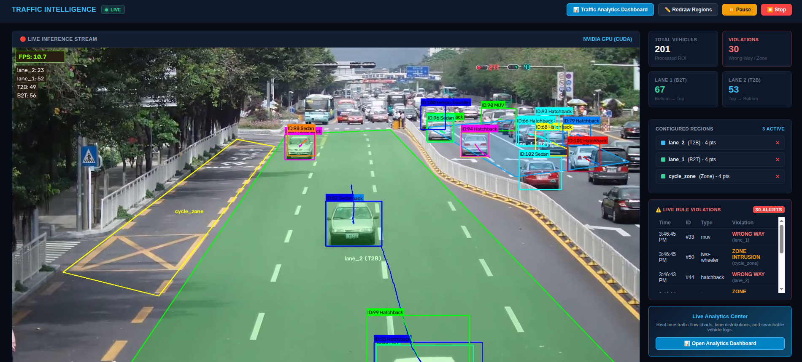
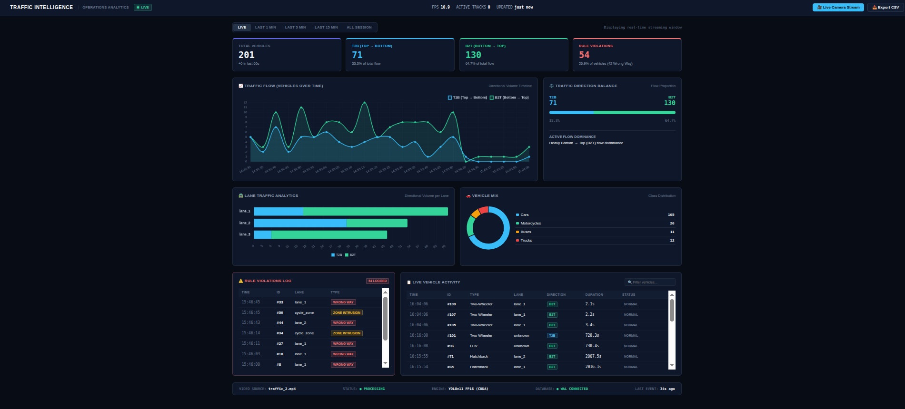
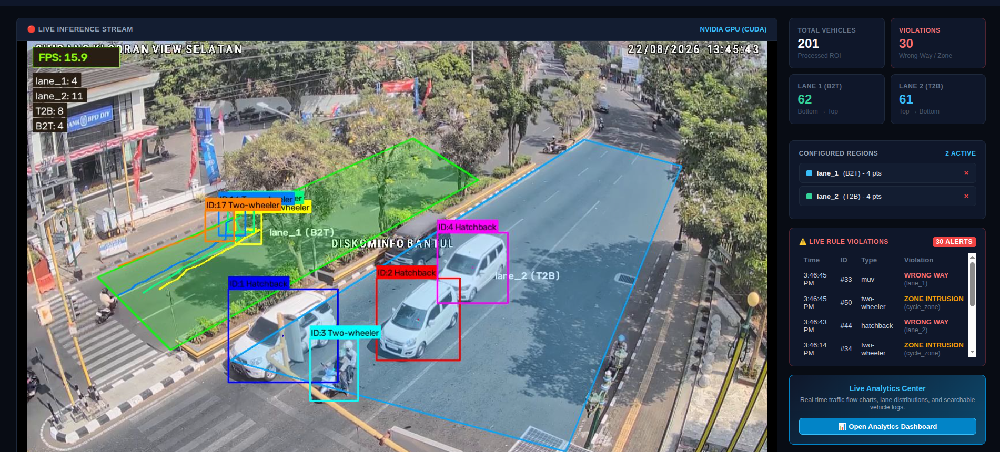
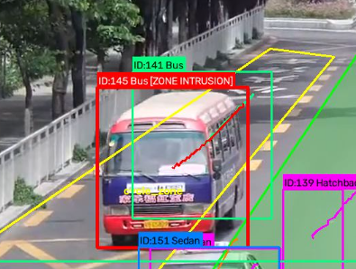
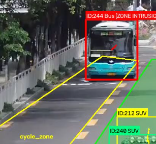
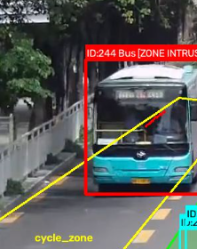

# 🚦 Traffic Surveillance & Intelligence System

> **"Don't just watch traffic. Turn traffic into structured, searchable traffic data."**







---

## 🚨 Visual Proof: Rule Enforcement & Cycle Zone Intrusion

The system enforces custom traffic safety rules in real time. Unauthorized 4-wheel vehicles entering designated cycle/pedestrian zones or travelling against directional flow are instantly flagged with visual evidence bounding boxes:

| Violation Evidence 1 | Violation Evidence 2 | Violation Evidence 3 |
|:---:|:---:|:---:|
|  |  |  |
| **Unauthorized vehicle entering cycle zone** | **Cycle zone breach detection** | **Restricted vehicle intrusion flagged** |

---

## 💡 The Core Philosophy

A conventional traffic surveillance camera only records raw video pixels:

> *"There are vehicles on the road."*

This system transforms a fixed traffic camera into an automated, continuous stream of **structured traffic intelligence**.

Instead of treating video as temporary footage, the pipeline extracts and structures every observation in real time:
- **Vehicle Classification & Multi-Object Tracking**: Persistent track IDs, vehicle classes (car, motorcycle, bus, truck, auto-rickshaw).
- **Spatial Lane Localization**: Exact 4-point perspective polygon evaluation using tire/ground-contact coordinates.
- **Directional Classification**: Bidirectional flow analysis (Top-to-Bottom `T2B` vs Bottom-to-Top `B2T`).
- **Traffic Rule Enforcement**: Wrong-way driving detection and unauthorized cycle/pedestrian zone intrusion monitoring.
- **Continuous Flow Metrics**: Vehicle velocity vectors, scene dwell time, and lane volume timelines.

### Why Structured Data Matters
Video footage is heavy, unindexed, and temporary. Structured event records in a database are lightweight, permanent, and instantly queryable.

A video shows *what happened visually*. Structured traffic data makes it possible to ask:
- *How is traffic volume divided between T2B and B2T directions?*
- *Which specific lane experiences the highest congestion during peak hours?*
- *What percentage of traffic consists of two-wheelers vs heavy commercial vehicles?*
- *When and where did specific traffic rule violations occur, and what is the visual evidence?*

---

## 🏛️ System Architecture

```text
                             ┌───────────────────────────────┐
                             │      Fixed Camera Stream      │
                             │     (traffic_2.mp4, RTSP)     │
                             └───────────────┬───────────────┘
                                             │
                                             ▼
 ┌────────────────────────────────────────────────────────────────────────────────────────┐
 │                      TRAFFIC PIPELINE (src/pipeline/traffic_pipeline.py)               │
 ├────────────────────────────────────────────────────────────────────────────────────────┤
 │  1. Video Decode         │ cv2.VideoCapture (Frame Buffering)                          │
 │  2. Vehicle Detection    │ YOLOv11 (FP16 Tensor Core Accelerated on NVIDIA CUDA)       │
 │  3. Multi-Object Tracker │ ByteTrack / SORT Matching (min_hits=1, max_age=30)          │
 │  4. Lane & Direction     │ 4-Point ROI pointPolygonTest at Ground Contact (cx, y2)     │
 │  5. Rule Enforcement     │ Multi-Frame Streak Verification (Wrong-Way & Zone Breach)   │
 │  6. Visual HUD Renderer  │ Real-Time Overlays, Alert Banners & Live Measured FPS Badge │
 └───────────────────────────────────────────┬────────────────────────────────────────────┘
                                             │  (Asynchronous Thread Queue)
                                             ▼
 ┌────────────────────────────────────────────────────────────────────────────────────────┐
 │                       EVENT DATABASE (src/storage/database.py)                         │
 ├────────────────────────────────────────────────────────────────────────────────────────┤
 │  • SQLite WAL Mode (Write-Ahead Logging) + Async Batch Commits for <0.3ms CV I/O       │
 │  • Tables: vehicles, events (violations), counts                                       │
 └───────────────────────────────┬───────────────────────┬────────────────────────────────┘
                                 │                       │
                                 ▼                       ▼
 ┌───────────────────────────────────────────┐ ┌──────────────────────────────────────────┐
 │       LIVE DASHBOARD (templates/dashboard.html)   │ │  OPERATIONS ANALYTICS (templates/analytics.html) │
 ├───────────────────────────────────────────┤ ├──────────────────────────────────────────┤
 │ • First-Frame Polygon Region Configurator │ │ • High-Frequency Polling (1.5s interval) │
 │ • Low-Latency MJPEG Live Stream           │ │ • Zero-Flicker In-Place Chart.js Updates │
 │ • Real-Time Measured FPS & Violation HUD  │ │ • Traffic Flow Timeline & Direction Gauge│
 │ • Interactive Pause / Stop Controls       │ │ • Lane Analytics & Vehicle Mix Breakdown │
 │                                           │ │ • Live Searchable Table & CSV Export     │
 └───────────────────────────────────────────┘ └──────────────────────────────────────────┘
```

---

## 🧠 Pipeline Processing Flow

The system flow is centralized in `src/pipeline/traffic_pipeline.py`:

1. **Frame Capture**: Reads incoming frame from the video source.
2. **Vehicle Detection (`src/pipeline/detector.py`)**: Executes YOLOv11 in FP16 on GPU to detect vehicle classes and bounding boxes.
3. **Multi-Object Tracking (`src/pipeline/tracker.py`)**: Associates detections across frames using IoU tracking to maintain continuous track IDs and trajectory histories.
4. **Lane & Direction Analysis (`src/pipeline/lane_analysis.py`)**: Tests the vehicle's ground-contact point `(cx, y2)` against configured lane polygons and computes net vertical movement (`T2B` vs `B2T`).
5. **Rule & Violation Analysis (`src/pipeline/traffic_rules.py`)**: Evaluates directional mismatch (Wrong-Way) and unauthorized vehicle intrusion in cycle/pedestrian zones using multi-frame streak verification.
6. **Asynchronous Persistence (`src/storage/database.py`)**: Queues structured vehicle records and violation events to an async SQLite WAL database worker thread.
7. **Evidence & Visualization (`src/visualization/evidence.py`)**: Renders polygon boundaries, color-coded bounding boxes, alert banners, and live measured FPS HUD onto the frame for live streaming.

---

## ✨ Key Features

- **Interactive First-Frame Region Configuration**: Draw custom perspective 4-point polygons for lanes and monitoring zones directly in the web UI or via standalone CLI script (`scripts/draw_regions.py`).
- **High-Speed GPU FP16 Acceleration**: YOLOv11 initialized directly on CUDA Tensor Cores in half-precision, processing at 25–35+ FPS.
- **Asynchronous Database Decoupling**: Database operations run in a background daemon thread, eliminating disk sync latency from the inference loop (< 0.3 ms).
- **Ground-Contact Geometry**: Evaluates bottom-center point `(cx, y2)` to ensure accurate perspective lane matching on elevated camera angles.
- **Multi-Frame Noise Filter**: Prevents detector jitter false alarms by requiring persistent displacement and 4 consecutive confirmation frames before flagging violations.
- **Dedicated Operations Analytics Dashboard**: Zero-reload live dashboard with real-time Chart.js graphs, lane distribution charts, vehicle mix donut, violation feed, and searchable vehicle activity table with CSV export.
- **Modular ANPR Subsystem**: Modular architecture preserved in `src/anpr/` for close-up camera streams (disabled by default on elevated wide-angle overview footage).

---

## 🚀 Quick Start

### 1. Clone the Repository
```bash
git clone https://github.com/priyanshu596/Traffic_survelliance.git
cd Traffic_survelliance
```

### 2. Create Virtual Environment & Install Dependencies
```bash
python3 -m venv myenv
source myenv/bin/activate  # On Windows: myenv\Scripts\activate
pip install -r requirements.txt
```

### 3. Ensure Model Weights & Video are in Place
- YOLOv11 model weights: `models/UVH-26-MV-YOLOv11-S.pt`
- Input video: `traffic_2.mp4`

### 4. Run the System
```bash
python dashboard.py -v traffic_2.mp4
```

### 5. Access the Web Interfaces
- **Live Stream & Region Drawer**: [http://localhost:5000](http://localhost:5000)
  1. Click 4 corner points around each lane on the first frame.
  2. Click **"🚀 START INFERENCE"**.
- **Operations Analytics Dashboard**: [http://localhost:5000/analytics](http://localhost:5000/analytics)

---

## 🛠️ CLI Options

```bash
python dashboard.py --help
```

| Argument | Type | Default | Description |
|---|---|---|---|
| `-v`, `--video` | string | `traffic_2.mp4` | Path to input traffic video file |
| `--vehicle-model` | string | `models/UVH-26-MV-YOLOv11-S.pt` | Path to YOLOv11 vehicle detector weights |
| `--device` | string | `cuda` (or `cpu`) | PyTorch device target (`cuda`, `0`, `cpu`) |
| `--conf` | float | `0.25` | Confidence detection threshold |
| `--iou` | float | `0.45` | IoU NMS threshold |
| `--port` | int | `5000` | Web dashboard port |
| `--no-annotated` | flag | `False` | Skip saving output annotated video to disk |

---

## 📂 Project Structure

```text
Traffic_survelliance/
├── config.py                     # Central configuration & dataclasses
├── dashboard.py                  # Clean, minimal application entry point
├── requirements.txt              # Production package dependencies
├── .gitignore                    # Comprehensive Git exclusion rules
├── README.md                     # Project documentation & architecture
│
├── src/                          # Core source code
│   ├── __init__.py
│   │
│   ├── pipeline/                 # Central Computer Vision Pipeline
│   │   ├── __init__.py
│   │   ├── traffic_pipeline.py   # Pipeline orchestrator (video -> CV -> DB -> visualizer)
│   │   ├── detector.py           # YOLOv11 FP16 GPU vehicle detector
│   │   ├── tracker.py            # Multi-object tracker & persistent track management
│   │   ├── lane_analysis.py      # Direction classification (T2B/B2T) & lane stats
│   │   ├── traffic_rules.py      # Rule engine (Wrong-Way & Zone Intrusion)
│   │   └── events.py             # Event & Detection data structures
│   │
│   ├── storage/                  # Persistence Layer
│   │   ├── __init__.py
│   │   └── database.py           # Asynchronous SQLite WAL event database & analytics queries
│   │
│   ├── visualization/            # Visual Evidence & HUD Renderer
│   │   ├── __init__.py
│   │   └── evidence.py           # Overlay renderer, alert banners & FPS display
│   │
│   ├── web/                      # Flask Web Application & REST APIs
│   │   ├── __init__.py
│   │   └── app.py                # Web routes & video streaming endpoints
│   │
│   └── anpr/                     # Modular Optional ANPR Subsystem
│       ├── __init__.py
│       └── plate_detector.py     # License plate detector interface
│
├── templates/                    # Clean Web UI Templates
│   ├── dashboard.html            # Live camera stream & region setup canvas
│   └── analytics.html            # Real-time operations analytics center
│
├── config/                       # Persisted Configurations
│   └── regions.json              # Saved polygon lane & zone definitions
│
├── scripts/                      # Utility Scripts
│   └── draw_regions.py           # Standalone OpenCV polygon configurator
│
├── images/                       # Documentation Screenshots & Evidence
│   ├── main-dashboard-1.png      # Live view & region drawing setup
│   ├── analytics-dashboard.png   # Operations Analytics Center
│   ├── main-dashboard-2.png      # Live detections feed
│   ├── violation1.png            # Visual violation evidence crop 1
│   ├── violation2.png            # Visual violation evidence crop 2
│   └── violation3.png            # Visual violation evidence crop 3
│
├── models/                       # Model Weights (gitignored)
│   ├── UVH-26-MV-YOLOv11-S.pt
│   └── license-plate-finetune-v1l.pt
│
└── output/                       # Output Artifacts & Databases (gitignored)
    └── traffic_events.db         # Structured SQLite analytics database
```

---

## 🔮 Future Roadmap: AI / VLM Natural Language Query Layer

Because every vehicle observation and traffic event is converted into indexed, structured tabular data in SQLite, the next evolution of this system is integrating a **Vision-Language Model (VLM) / LLM Agent layer**.

Operators will be able to query the camera using plain natural language:
- *"How many heavy trucks travelled in Lane 1 between 2:00 PM and 3:00 PM?"*
- *"Show me visual evidence of all wrong-way driving events from today."*
- *"What was the peak traffic flow rate in the Top-to-Bottom direction?"*

```text
                     ┌────────────────────────────────────────┐
                     │    Natural Language Query Interface    │
                     │  "Show me wrong-way vehicles at 2 PM"  │
                     └───────────────────┬────────────────────┘
                                         │
                                         ▼
                     ┌────────────────────────────────────────┐
                     │         LLM / Text-to-SQL Agent        │
                     └───────────────────┬────────────────────┘
                                         │
                                         ▼
                     ┌────────────────────────────────────────┐
                     │   Structured SQLite Traffic Database   │
                     └────────────────────────────────────────┘
```

---

## 🏁 Summary

> **"Don't just watch traffic. Turn traffic into data."**

This project bridges the gap between raw computer vision bounding boxes and actionable traffic analytics, delivering a production-ready intelligence platform for smart cities and modern traffic operations centers.
